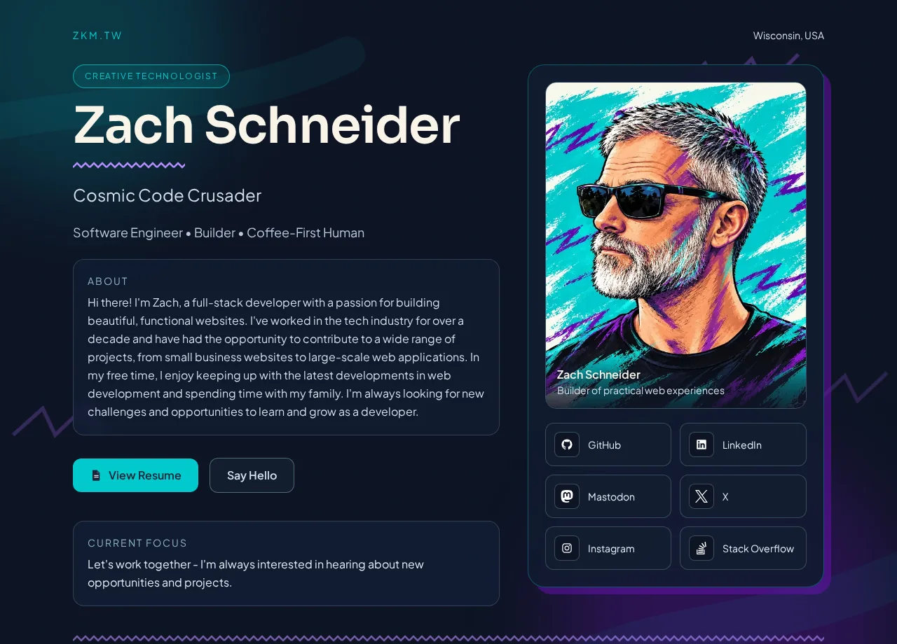

# [zkm.tw](https://zkm.tw)

<p align="center">
  <a href="https://github.com/zkm/zkm.tw/actions/workflows/ci.yml"></a>
  <a href="https://github.com/zkm/zkm.tw/actions/workflows/coverage.yml"></a>
  <a href="https://github.com/zkm/zkm.tw/actions/workflows/deploy.yml"></a>
  <a href="https://github.com/zkm/zkm.tw/releases/latest"></a>
</p>

<p align="center">
  
  
  
  
  
  
  
</p>

Zach Schneider's portfolio and interactive resume: one page, a resume that opens over it, and a
teal-and-purple '90s look taken from his illustrated avatar.

<p align="center">
  <a href="https://zkm.tw"></a>
</p>

## Features

- **Resume pop-up**: collapsible sections, skill cards, a Chart.js skills chart (lazy-loaded with
  the resume) and print styles for a clean paper copy.
- **Content in JSON**: profile, experience and skills come from `public/data/*.json` at runtime,
  so updating the site rarely means touching a component.
- **Accessible**: a skip link, focus trapped in dialogs, WCAG AA contrast or better throughout,
  and animation turned down for anyone who prefers reduced motion.
- **Contact details kept from scrapers**: the email and phone number are stored encoded and only
  decoded when a visitor asks to see them.

## Design

The palette comes from the avatar:

| Color | Hex | Used for |
|---|---|---|
|  Teal | `#02cacc` | Accents, primary buttons, links on dark backgrounds |
|  Dark teal | `#00777a` | Teal text on white (the resume's content area) |
|  Purple | `#6511aa` | Zigzags, offset shadows, the second accent |
|  Coral | `#f29260` | A third accent in the resume (text: `#a3461a`) |
|  Navy | `#0e1424` | Page background |
|  Cream | `#f9f4e8` | Text on navy |

`src/index.css` has the shared accents, used across the page and the resume:

| Class | Effect |
|---|---|
| `jazz-link` | Underline that turns into a purple zigzag on hover (add `jazz-link-light` on white) |
| `jazz-pop` | Lifts on hover with a hard offset shadow, purple by default (`jazz-pop-teal`, `-coral`, `-slate`) |
| `jazz-zigzag` | A purple zigzag rule (under headings, above the footer) |
| `jazz-divided` | A faint zigzag between stacked items on white |

## Getting started

Prerequisites: Node 24+, Yarn 4 (via Corepack).

```bash
yarn install
yarn dev        # Vite dev server
yarn verify     # lint, format check, typecheck and tests; run before opening a PR
```

## Scripts

| Script | What it does |
|---|---|
| `dev` / `build` / `preview` | Vite dev server, production build into `dist/`, serve that build |
| `verify` | `lint`, `format:check`, `typecheck` and `test`: what CI runs |
| `fix` | Biome lint and format, writing fixes (`lint`, `lint:fix`, `format`, `format:check` do one part) |
| `typecheck` | `tsc` over the app, Node and test configs; `typecheck:worker` covers `workers/chat` |
| `test` / `test:watch` / `test:ui` | Vitest once, in watch mode, or with its browser UI |
| `test:coverage` | Coverage for every file in `src/`, tested or not (report in `coverage/`) |
| `docker:dev` / `docker:prod` / `docker:down` | See [Docker](#docker) |
| `health`, `deps:*` | Dependency health, audit and update helpers (see `package.json`) |

## Content and code

Site copy, experience and skills live in JSON, not in components. Edit those files to change
the site; [docs/data-schema.md](docs/data-schema.md) documents every field.

```
public/
  data/profile.json, resume.json   # site content, fetched at runtime
  zach.webp, zach.jpg              # the portrait (WebP, with a JPEG fallback)
  analytics.js                     # GA4 setup (gtag is loaded in index.html)
src/
  main.tsx → App.tsx               # entry
  index.css                        # Tailwind, and the jazz-* accents
  components/
    Portfolio.tsx                  # the page
    Resume.tsx                     # lazy-loaded resume and skills chart
  hooks/                           # useProfileData, useResumeData, useFocusTrap, usePrefersReducedMotion
  __tests__/
workers/chat/                      # Cloudflare Worker for an AI chat widget (currently unused; docs/chat-worker.md)
```

Tests mock Framer Motion and Lucide globally in `src/test-setup.ts`. A new icon or animated
component may need an entry there.

## Docker

For local use only; production doesn't run on Docker or nginx.

- `yarn docker:dev`: Vite with hot reload on http://localhost:5173
- `yarn docker:prod`: the built site served by nginx on http://localhost:8082

## Deployment

Pushing a `vX.Y.Z` tag on `master` releases and deploys it, after approval: GitHub Actions runs
CI, saves the build on a GitHub Release, and has DigitalOcean App Platform build and serve that
tag. Merging to `master` alone deploys nothing. CI (`yarn verify` + `yarn build`) runs on every
pull request. Releasing, rolling back and setup: [docs/deploy.md](docs/deploy.md).

---

<p align="center">
  Created by <a href="https://zachschneider.com">Zach Schneider</a>
</p>
